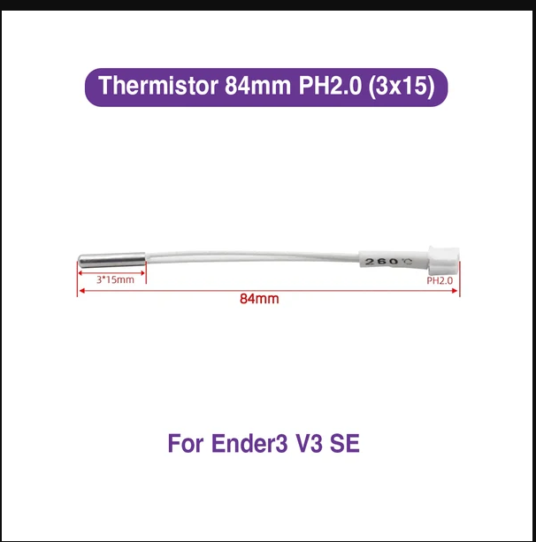

# Heater upgrade

After getting `verify_heater` errors in klipper, decided to upgrade the stock hotend (bi metallic heat break) to official creality ceramic hotend

- printed PLA - and the earlier fan duct is not compatible - can see cooling issue. 

- decided to print another fan duct - but looks like it's a wrong decision.
  https://www.printables.com/model/677949-ender-3-v3-se-5015-blower-duct-mod 
looks like this is meant for stock hotend.

- this one looks promising.
https://www.printables.com/model/667051-dual-5015-blower-duct-for-ender-3-v3-se

going to print left and right volcano stl files: result: this one is also bad

- https://www.printables.com/model/1293501-ender-3-v3-se-cooling-duct-prusa-mk4s

https://www.reddit.com/r/Ender3V3SE/comments/1x2jz1f/comment/pfdzlsb/?utm_source=share&utm_medium=web3x&utm_name=web3xcss&utm_term=1&utm_content=share_button

Already confirmed by someone from reddit. Thanks to him

## Heater and thermistor upgrades

My stock hotend thermistor went bad - These are the dimensions of stock hotend thermistor
and heater

### thermistor

- dia: 3 mm
- length: 15 mm
- wire length: 84 mm (including 15mm metallic part)
- 
- stock thermistor replacement: 

- https://makerparts3d.com/products/thermistor-84mm-ph2-0-3x15-for-ender-3-v3-se

#### Options
- https://novo3d.in/ntc-sensor/
  * this one is the best
  * dia: 3mm; length: 15 mm
  * wire length: 150mm
- https://novo3d.in/creality-thermistor-cartridge/
    * length: 10mm, dia: 3mm
    * wire length: 70 mm; 
    * PH2.0 terminal
    * creality k1, creality k1 max

### heater

- dia: 6 mm
- length: 19mm
- 40W
- voltage: 24v
- official link: https://makerparts3d.com/products/24v-40w-heater-cartridge-for-ender-3-v3-se-6x20mm

### Options
- https://novo3d.in/24v-50w-heater-cartridge/
  * elgood neptune printer
  * dia: 6 mm and length: 20mm
  * wire len: 67mm
  * 50W
