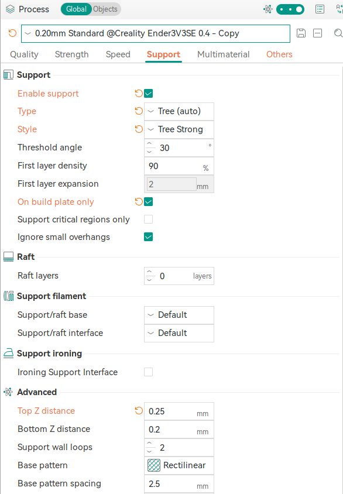
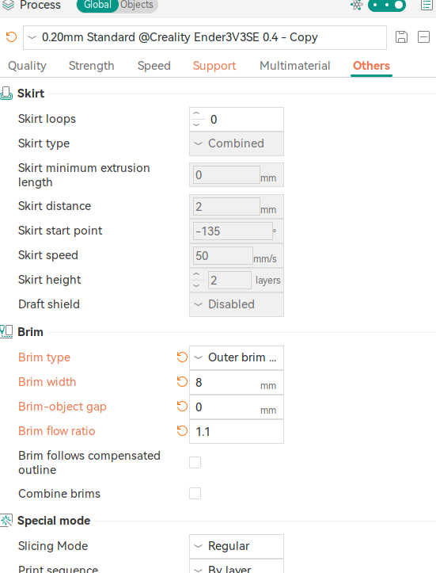

# important settings and behavior

## shrinkage

- put 99.4

## support settings

- Top Z distance: 0.25 works very well with Tree strong

- use Tree Strong for large prints
- for printing fan duct - prefer to select support on build plate only
- increase the brim flow ration to 1.3 from 1.0 for better adhesion. 

