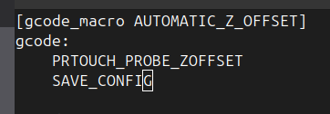

# using the load cell on ender 3v3 se

use following fork:
https://github.com/0xD34D/klipper_ender3_v3_se

this fork implements hx711s.c and dirzctl.c, which upstream does not have.

you would need to flash the firmware 

Create prtouch.cfg with contents from 0xD34D
```
ami@octoprint:~/printer_data/config $ cat prtouch.cfg 
[filter]

[dirzctl]

[hx711s]
sensor0_clk_pin: PA4             # Pressure detection clock pin
sensor0_sdo_pin: PC6             # Pressure detection data pin

[prtouch]
sensor_x: 32
sensor_y: 30
clr_noz_start_x: 15
clr_noz_start_y: 25
clr_noz_len_y: 15
s_hot_min_temp: 160
s_hot_max_temp: 200
s_bed_max_temp: 60
show_msg: True
wipe_retract_distance: 2
```

use following command

```
PRTOUCH_PROBE_ZOFFSET

```

This will calculate z offset, then run `SAVE_CONFIG` afterwards

I've a macro too



I've noticed that the z offset calculation is generally off by 0.06mm 

```
commit 5814eeb92dbd65a0dad207730f7ee40fa62e3b83
Author: Amitesh Singh <singh.amitesh@gmail.com>
Date:   Tue Oct 13 09:52:23 2026 +0530

    new z offset after abs printing - looks good

diff --git a/printer.cfg b/printer.cfg
index b0793fc..7e69650 100644
--- a/printer.cfg
+++ b/printer.cfg
@@ -269,7 +269,7 @@ pin: PB0
 #*# DO NOT EDIT THIS BLOCK OR BELOW. The contents are auto-generated.
 #*#
 #*# [bltouch]
-#*# z_offset = 2.080
+#*# z_offset = 2.020
 #*#
 #*# [bed_mesh default]
 #*# version = 1
```

- possible solutions
    * live with it, and adjust 0.06 everytime
    * try 
```
PRTOUCH_PROBE_ZOFFSET PROBE_SPEED=1.0
```
To make it permanent: add following entry in printer.cfg
```
prtouch]
probe_speed: 1.0
```
Default is 2.0, valid range is 0.1 to 10.0 mm/s.


