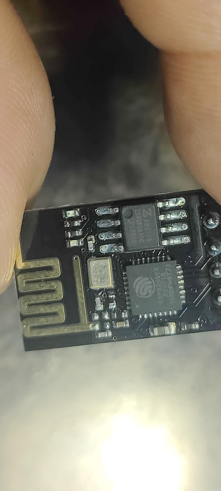
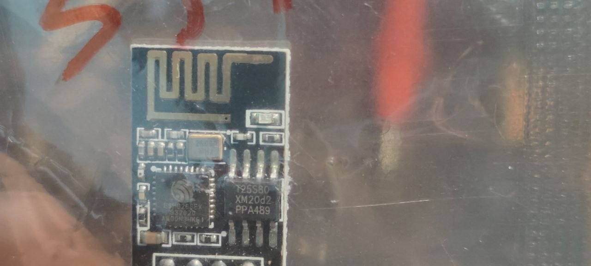
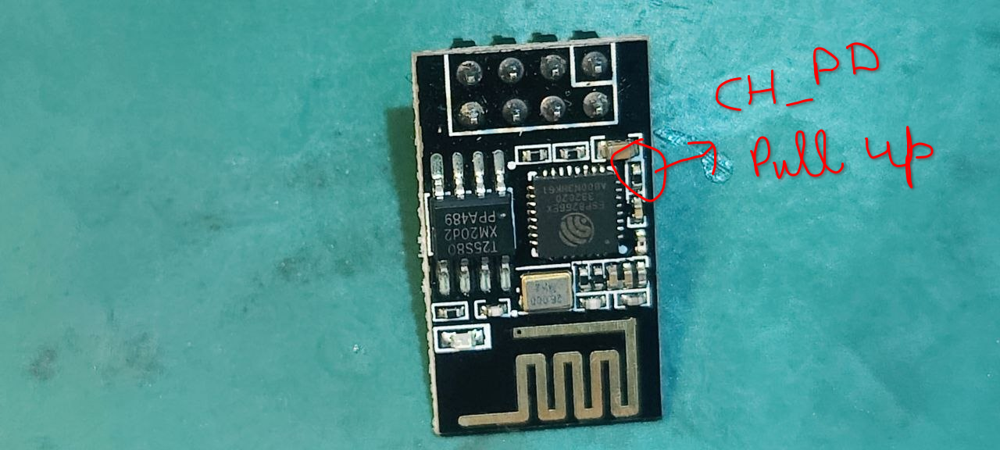

# esp01

## esp01 vs esp01s


## Verify esp01 flash size using esptool

put the esp01 into bootloader mode and use following command


```
$ esptool.py --port /dev/ttyUSB0 flash-id
WARNING: DEPRECATED: 'esptool.py' is deprecated. Please use 'esptool' instead. The '.py' suffix will be removed in a future major release.
esptool v5.6.0
Connected to ESP8266 on /dev/ttyUSB0:
Chip type:          ESP8266EX
Features:           Wi-Fi, 160MHz
Crystal frequency:  26MHz
MAC:                94:b9:7e:07:d4:dc

Stub flasher is already running. No upload is necessary.

Flash Memory Information:
=========================
Manufacturer: 5e
Device: 6014
Detected flash size: 1MB

Hard resetting via RTS pin...

```

Manufacturer: 5e means is for Zbit: ZB25VQ80
 -> does not have pull up at CH_PD/EN pin, and the led pin is at Tx (GPIO1)



This one has 12k pull up at `CH_PD`. also the led pin is at GPIO2

##
